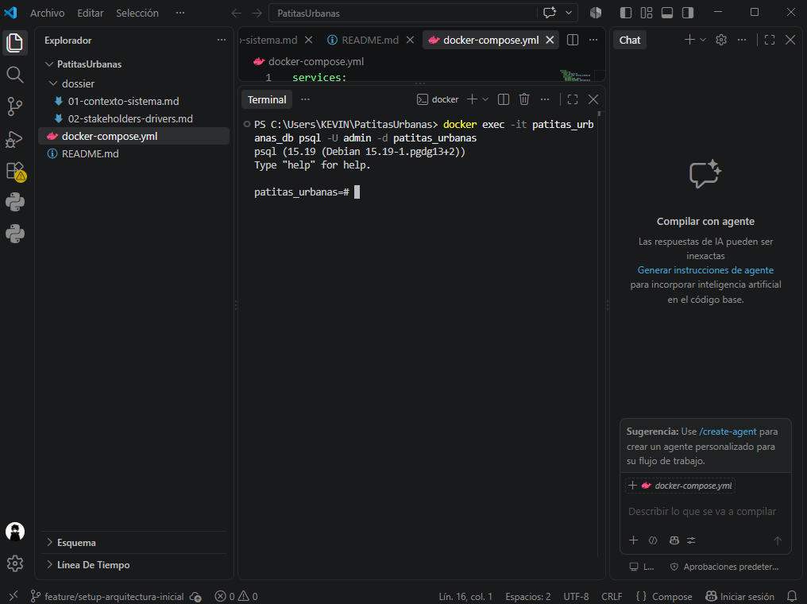
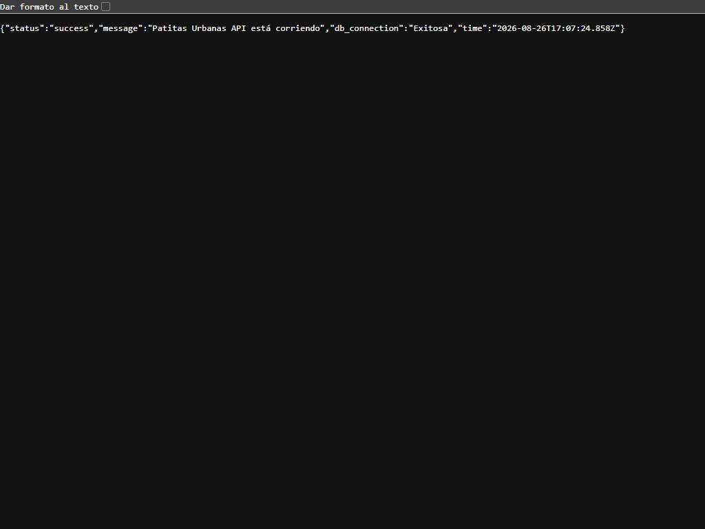
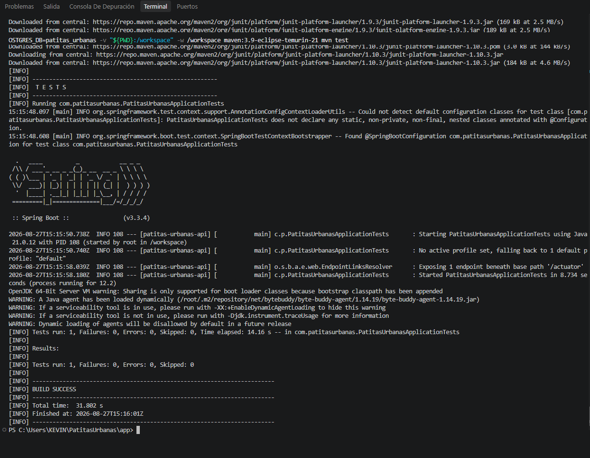

# PatitasUrbanas

## Levantar la base de datos

El proyecto utiliza PostgreSQL mediante Docker Compose. Para levantar la base de datos después de clonar el repositorio:

1. Instala [Docker Desktop](https://www.docker.com/products/docker-desktop/) y asegúrate de que esté iniciado.
2. Abre una terminal en la carpeta raíz del proyecto.
3. Copia `.env.example` como `.env` y cambia la contraseña. `.env` no se versiona.
4. Crea la clave pública que valida los tokens (requiere `pip install pyjwt cryptography`):

```powershell
python experimentos/14-fuga-datos-s13/generar_tokens.py secretos
```

5. Si ya levantaste el proyecto antes de este cambio, borra el volumen anterior. PostgreSQL guarda la contraseña en el volumen y no toma la nueva de `.env`, así que la API no podría conectarse. **Esto borra los datos locales:**

```powershell
docker compose down -v
```

6. Ejecuta:

```powershell
docker compose up -d
```

Este comando crea el contenedor `patitas_urbanas_db`, inicia PostgreSQL 16 y conserva los datos en el volumen `pgdata_v16`. En Compose, la API usa `ddl-auto=update`, así que un reinicio no borra las tablas. Con `mvn spring-boot:run` se mantiene `create-drop`: al reiniciar se borran.

Para comprobar el estado del servicio:

```powershell
docker compose ps
```

Para detener el servicio sin eliminar los datos:

```powershell
docker compose down
```

Datos de conexión local:

- Host: `localhost`
- Puerto: `5433`
- Nota: 5433 al conectarte desde tu máquina; 5432 es el puerto interno usado entre contenedores de Docker.
- Base de datos: `patitas_urbanas`
- Usuario: `admin`
- Contraseña: la que definiste en `.env`
- Los puertos 5433 y 3000 solo escuchan en `127.0.0.1`.

Para llamar a `POST /api/adopciones` se necesita un token. El comando del paso 4 deja uno de prueba, válido por 24 horas, en `secretos/valido.jwt`.

Para ejecutar las pruebas con esta misma BD, define la contraseña de `.env` en la terminal. **Las pruebas usan `create-drop` y borran las tablas:** al terminar, reinicia la API con `docker compose restart api_app`.

```powershell
$env:POSTGRES_PASSWORD="la-de-tu-.env"
cd app
mvn test
```

Despliegue propuesto, con TLS y sin publicar la API ni la BD:

```powershell
docker compose -f docker-compose.yml -f docker-compose.produccion.yml up -d
```

## Evidencia de Ejecución Local (Semana 1)
A continuación, se demuestra la correcta inicialización del contenedor y la conexión exitosa al motor de base de datos PostgreSQL en el entorno de desarrollo local.



## Evidencia de Ejecución de la API



## Validación de pruebas

Las pruebas de validación confirman de manera consistente que el *healthcheck* de la base de datos se mantiene en estado `healthy` y que el endpoint de la API responde con el código de estado HTTP `200`.


## Módulo 5 — Dominio, integración y Spike 1 (Semanas 9–10)

| Entregable | Dónde está |
|---|---|
| 1. Modelo del dominio y Context Map | [`docs/dominio/modelo-dominio.md`](docs/dominio/modelo-dominio.md) (evidencia y decisiones), [`docs/dominio/subdominios.md`](docs/dominio/subdominios.md), [`docs/dominio/responsabilidades-contextos.md`](docs/dominio/responsabilidades-contextos.md), [`docs/dominio/context-map.puml`](docs/dominio/context-map.puml) ([PNG](docs/dominio/context-map.png)) |
| 2. Decisión síncrono / asíncrono | [`docs/integracion/sincrono-vs-asincrono.md`](docs/integracion/sincrono-vs-asincrono.md) |
| 3. Contrato API | [`docs/integracion/contrato-api.yaml`](docs/integracion/contrato-api.yaml) (OpenAPI 3.0) |
| 4. Eventos candidatos | [`docs/integracion/eventos-candidatos.md`](docs/integracion/eventos-candidatos.md) |
| 5. CQRS y Event Sourcing | [`docs/integracion/cqrs-event-sourcing.md`](docs/integracion/cqrs-event-sourcing.md), [`dossier/17-cqrs-consistencia-eventual-s10.md`](dossier/17-cqrs-consistencia-eventual-s10.md) |
| 6. Preregistro del Spike 1 | [`experimentos/04-spike-especificacion-s9.md`](experimentos/04-spike-especificacion-s9.md) |
| 6b. Preregistro del Spike 2 (integración Adopciones ↔ Mascotas) | [`experimentos/08-spike-integracion-especificacion.md`](experimentos/08-spike-integracion-especificacion.md) |
| 7. Rama experimental | `spike/fronteras-modulares-s10` (desde `887ccf1`); control descartable `spike/control-y2-descartable` |
| 8. Ejecución, resultados y veredicto | [`experimentos/06-spike-resultado-s10.md`](experimentos/06-spike-resultado-s10.md), evidencia en [`experimentos/spike-s10/`](experimentos/spike-s10/); orden temporal verificado en [`experimentos/07-trazabilidad-temporal.md`](experimentos/07-trazabilidad-temporal.md) |
| 9. ADR 3 | [`adr/adr-03-limites-y-comunicacion-modulos.md`](adr/adr-03-limites-y-comunicacion-modulos.md) |
| 10. Registro crítico de IA | [`experimentos/05-auditoria-ia-s9.md`](experimentos/05-auditoria-ia-s9.md) (spike), [`docs/integracion/registro-ia-modulo5.md`](docs/integracion/registro-ia-modulo5.md) (dominio e integración) |

## Semana 11 — Experimento de crecimiento

| Entregable | Dónde está |
|---|---|
| Preregistro: escenario, vínculo con la línea base, hipótesis H1–H4 y reglas de análisis | [`experimentos/10-crecimiento-s11/README.md`](experimentos/10-crecimiento-s11/README.md) (commit `964dd4a`, [PR #66](https://github.com/Charry21/PatitasUrbanas/pull/66)) |
| Script de carga (50, 100, 150 y 200 usuarios) y orquestador | [`escenario-crecimiento.js`](experimentos/10-crecimiento-s11/escenario-crecimiento.js), [`ejecutar.sh`](experimentos/10-crecimiento-s11/ejecutar.sh) |
| Saturación del generador (CPU por segundo) | [`muestreo_cpu.py`](experimentos/10-crecimiento-s11/muestreo_cpu.py); resultado en H4 |
| Desviaciones registradas antes de medir | [`entorno/desviaciones.md`](experimentos/10-crecimiento-s11/entorno/desviaciones.md) |
| Resultados, conclusiones y límites | [`experimentos/10-crecimiento-s11/RESULTADOS.md`](experimentos/10-crecimiento-s11/RESULTADOS.md) ([PR #67](https://github.com/Charry21/PatitasUrbanas/pull/67)) |
| Datos crudos, bitácoras y análisis | [`resultados/`](experimentos/10-crecimiento-s11/resultados/), [`analizar.py`](experimentos/10-crecimiento-s11/analizar.py) |
| Trazabilidad del análisis y orden temporal | [`trazabilidad-analisis.md`](experimentos/10-crecimiento-s11/trazabilidad-analisis.md) |

## Módulo 6 — Resiliencia, distribución y fitness functions (Semanas 11–14)

> Nota (2026-11-06, I-14): según la guía del tutor, las semanas 13 y 14 corresponden al Módulo 7. El mini-comité del ADR-04 (Semana 13) queda en esta sección porque cierra ese ADR.

| Paso | Entregable | Dónde está |
|---|---|---|
| A1 | Experimento de crecimiento (50–200 usuarios) y semilla de datos y memoria | [`experimentos/10-crecimiento-s11/`](experimentos/10-crecimiento-s11/), [`experimentos/13-semilla-memoria-s12/`](experimentos/13-semilla-memoria-s12/) |
| A2 | Matriz de fallos (observados / hipotéticos) | [`docs/resiliencia/matriz-fallos.md`](docs/resiliencia/matriz-fallos.md), evidencia de [`experimentos/12-inyeccion-fallos-s12/`](experimentos/12-inyeccion-fallos-s12/) |
| A3 | Matriz de resiliencia | [`docs/resiliencia/matriz-resiliencia.md`](docs/resiliencia/matriz-resiliencia.md) |
| A4 | Distribución y costos | [`docs/distribucion/comparacion-distribucion.md`](docs/distribucion/comparacion-distribucion.md) |
| A5 | ADR 4 (veredicto del comité: **Ajustada**, 2026-10-31) | [`adr/adr-04-distribucion.md`](adr/adr-04-distribucion.md) · acta: [`dossier/evidencia-comite-adr04.md`](dossier/evidencia-comite-adr04.md) |
| A6 | Fitness function FF-01 en CI | [`docs/fitness/ff-01-fronteras-modulares.md`](docs/fitness/ff-01-fronteras-modulares.md), [`.github/workflows/fitness-functions.yml`](.github/workflows/fitness-functions.yml) |
| — | Autoauditoría A1–A6 | [`docs/auditoria-modulo6.md`](docs/auditoria-modulo6.md) |
| — | Registro crítico de IA | [`docs/registro-ia-modulo6.md`](docs/registro-ia-modulo6.md) |

## Módulo 7 — Seguridad, despliegue, observabilidad y operación (Semanas 13–14)

Borradores de la IA revisados por el equipo el 2026-11-06. ADR-05 está **aceptada**, con el emisor de tokens aplazado.

| Semana | Entregable | Dónde está |
|---|---|---|
| 13 | Modelado de amenazas y matriz de riesgos y controles | [`docs/10-seguridad.md`](docs/10-seguridad.md) |
| 13 | Prueba de fuga de datos | [`experimentos/14-fuga-datos-s13/`](experimentos/14-fuga-datos-s13/) ([resultados](experimentos/14-fuga-datos-s13/RESULTADOS.md)) |
| 13 | Costo de seguridad sobre el p95 | [`experimentos/15-costo-seguridad-s13/`](experimentos/15-costo-seguridad-s13/) ([resultados](experimentos/15-costo-seguridad-s13/RESULTADOS.md)) |
| 13 | Ciclo EDAV 3 (formativo) | [`docs/EDAV-03.md`](docs/EDAV-03.md): auditada y firmada el 2026-11-06 |
| 14 | Diagrama de despliegue, alternativas, observabilidad y plan de operación | [`docs/12-despliegue-observabilidad.md`](docs/12-despliegue-observabilidad.md) |
| 14 | Riesgos operativos y compromisos | [`docs/13-riesgos-tradeoffs.md`](docs/13-riesgos-tradeoffs.md) |
| 14 | R-10 y R-11 (condición del ADR-04) | [`experimentos/16-reinicio-automatico-s14/`](experimentos/16-reinicio-automatico-s14/) ([resultados](experimentos/16-reinicio-automatico-s14/RESULTADOS.md)) |
| 14 | ADR 5 | [`adr/adr-05-seguridad-y-operacion.md`](adr/adr-05-seguridad-y-operacion.md) |
| 14 | Fitness functions en CI | [`docs/fitness/ff-01-fronteras-modulares.md`](docs/fitness/ff-01-fronteras-modulares.md), [`docs/fitness/ff-02-configuracion-segura.md`](docs/fitness/ff-02-configuracion-segura.md) (llega con el [PR #83](https://github.com/Charry21/PatitasUrbanas/pull/83)), [`.github/workflows/fitness-functions.yml`](.github/workflows/fitness-functions.yml) |
| — | Autoauditoría e inconsistencias | [`docs/auditoria-modulo7.md`](docs/auditoria-modulo7.md) |
| — | Registro crítico de IA | [`docs/registro-ia-modulo7.md`](docs/registro-ia-modulo7.md) |

La capa de seguridad, el Compose de producción, R-10 y R-11 están en el [PR #83](https://github.com/Charry21/PatitasUrbanas/pull/83), sin fusionar: `main` sigue sin esos controles.

## Glosario de identificadores (I-07)

Varios prefijos se repiten con significados distintos. Al citarlos, conviene indicar el archivo.

| Identificador | Qué es | Dónde |
|---|---|---|
| R-01 a R-12 | Tácticas de resiliencia | `docs/resiliencia/matriz-resiliencia.md` |
| R-01 a R-05 | Riesgos iniciales del dominio | `dossier/02-stakeholders-drivers.md` |
| R01 a R04 | Riesgos de otra lista, con otro contenido | `dossier/04-riesgos.md` |
| R1 a R5 | Relaciones del mapa de contextos | `docs/dominio/context-map.puml` |
| R1 a R3 | Reglas de FF-01 | `docs/fitness/ff-01-fronteras-modulares.md` |
| F-01 a F-14 | Escenarios de fallo | `docs/resiliencia/matriz-fallos.md` |
| T-01 a T-18 | Amenazas STRIDE | `docs/10-seguridad.md` |
| RS-01 a RS-17 | Riesgos de seguridad | `docs/10-seguridad.md` |
| RO-01 a RO-14 · TO-01 a TO-10 | Riesgos operativos y compromisos | `docs/13-riesgos-tradeoffs.md` |
| P01 a P13 | Sondas de la prueba de fuga | `experimentos/14-fuga-datos-s13/` |
| QA-03 y BIZ-01 | Significan cosas distintas según el archivo | `dossier/02` y `dossier/04` (ver sus notas) |
