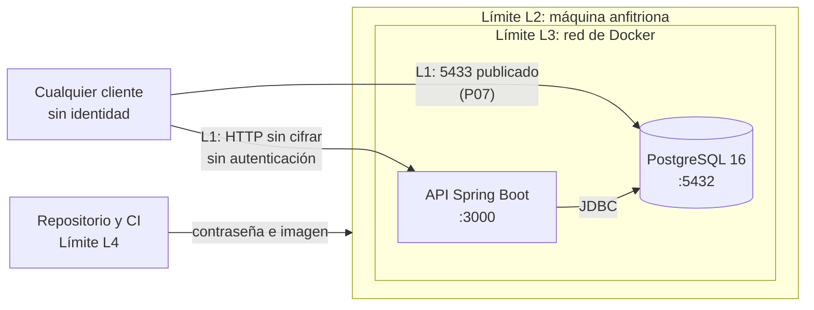

# Seguridad arquitectónica — Semana 13

> **Estado: revisado por el equipo el 2026-11-06.** ADR-05 está aceptada. Los tratamientos de §4 son decisiones del equipo, con RS-14 y RS-16 aplazados. **Probabilidad e impacto los calificó el equipo** con una escala acordada (revisión manual S6, 2026-11-06).

Fecha: 2026-11-05. Código analizado: `main` en `3f4b124`.

**Conclusión:** el sistema no es seguro para exponerlo a internet. `main` no tiene autenticación, ni TLS, y publica la base de datos con una contraseña que está en el repositorio. Lo que atenúa el riesgo hoy es que no hay despliegue público ni datos personales guardados. La rama `feat/s13-capa-seguridad` propone los controles; hasta que el equipo la fusione, **`main` sigue como se describe aquí**.

---

## 1. Sistema y límites

Solo se modela lo que existe en el código, con el mismo criterio de la matriz de fallos. Notificaciones, Servicio de Mapas, Identidad y los clientes web y móvil no existen.

| Límite | Entre | Qué cruza hoy |
|---|---|---|
| L1 | Red externa ↔ contenedores | HTTP en claro hacia la API y conexión directa a la BD |
| L2 | Anfitrión ↔ contenedores | Variables de entorno, logs, volúmenes |
| L3 | API ↔ BD | JDBC sin TLS, con usuario y contraseña |
| L4 | Repositorio ↔ ejecución | Contraseña versionada y dependencias sin fijar por resumen |

### Activos

| Id | Activo | Hoy | Propiedad que importa |
|---|---|---|---|
| A1 | Solicitudes y etapas (`estado`, `nombre_etapa`, fechas) | Existe | Integridad (QA-02) |
| A2 | Credenciales de la BD | Existe, versionada | Confidencialidad |
| A3 | Disponibilidad de la API y de la BD | Existe | Disponibilidad |
| A4 | Información interna: rutas, motor, excepciones, volumen de datos | Existe | Confidencialidad |
| A5 | Logs | Existen | Integridad y confidencialidad |
| A6 | Clave de firma de tokens | **No existe**: nace con la capa propuesta | Confidencialidad |
| A7 | Datos personales de adoptantes y ubicación (Ley 1581) | **No existe en el código** | Confidencialidad; se revisa todo al crear Identidad |

---

## 2. Modelado de amenazas (STRIDE)

**Estado:** **Observada** = una prueba la provocó. **Observada, sin éxito** = se intentó y no funcionó. **Hipotética** = plausible por el diseño, sin provocar. **Con el control** = aparece por la capa propuesta.

| Id | Elemento | STRIDE | Amenaza | Activo | Impacto posible | Estado | Dónde se identificó |
|---|---|---|---|---|---|---|---|
| T-01 | Cliente → `POST /api/adopciones` | Suplantación | Cualquiera crea solicitudes, sin identidad | A1 | Solicitudes falsas | **Observada** | P06, P13: 201 sin token y con 7 tokens inválidos |
| T-02 | Parámetros `estado`, `nombreEtapa` | Manipulación | Texto libre: se puede crear una solicitud en cualquier estado | A1 | Estados incoherentes | **Observada** | P05 guardó las cargas como texto; `contrato-api.yaml` lo declara |
| T-03 | Repositorios JPA | Manipulación | Inyección SQL (riesgo R-01 de `dossier/02`) | A1 | Lectura o borrado | **Observada, sin éxito** | P05: 3 cargas en 2 parámetros, tablas intactas |
| T-04 | API | Repudio | No queda registro de quién hizo qué ni de los intentos | A5 | Un abuso no se puede investigar | **Observada** | Revisión del código; escenario 2 sin implementar |
| T-05 | `GET /actuator/health` | Revelación | Muestra motor de BD, ruta y tamaño de disco a anónimos | A4 | Facilita un ataque dirigido | **Observada** | P03 |
| T-06 | Respuesta de `POST /api/adopciones` | Revelación | `idSolicitud` secuencial revela el volumen de solicitudes | A4 | Información de negocio | **Observada** | P06: 18, 19 |
| T-07 | `POST /api/adopciones/test-fallo` | Revelación | Endpoint de prueba abierto; devuelve el mensaje de la excepción | A4 | Superficie innecesaria | **Observada** | P04 |
| T-08 | Puerto 5433 | Revelación y manipulación | Desde otra red se entra a la BD con la contraseña del repositorio | A1, A2 | **Lectura y escritura total** | **Observada** | P07. `dossier/02` R-05 ya pedía una red privada |
| T-09 | Repositorio, jar, variables | Revelación | Contraseña en 4 líneas versionadas y dentro del jar | A2 | Credencial conocida por cualquiera con acceso | **Observada** | P08 |
| T-10 | Cliente ↔ API | Revelación y manipulación | HTTP en claro; `dossier/06` dice HTTPS | A1, A6 | Lectura y alteración en tránsito | **Observada** | P11 |
| T-11 | API | Denegación de servicio | Sin límite de peticiones; sin autenticación se llena la BD | A1, A3 | Degradación y crecimiento sin límite | **Hipotética** | S11 soporta 200 usuarios, pero nada limita más; F-10 |
| T-12 | Logs | Denegación de servicio | Cada petición genera log SQL en DEBUG, sin rotación | A3, A5 | Disco lleno | **Hipotética** en la consecuencia | F-11: 176 MB en S11 |
| T-13 | `ddl-auto=create-drop` | Denegación de servicio | Provocar un reinicio borra todos los datos | A1 | Pérdida total | **Observada** en el efecto | HR2 del experimento 16: 5/5 |
| T-14 | Contenedor de la API | Elevación | El proceso corre como root | A3 | Más daño si se compromete la API | **Observada** la condición; consecuencia **hipotética** | P12 |
| T-15 | Dependencias, imágenes y acciones de CI | Manipulación | Etiquetas sin fijar por resumen y sin análisis de vulnerabilidades | A1–A3 | Código malicioso en la cadena | **Hipotética** | `app/Dockerfile`, `docker-compose.yml`, workflow |
| T-16 | Validación de tokens | Suplantación | Tokens forjados: `alg=none`, confusión HS256, otra firma | A1 | Saltarse la capa | **Con el control**, observada sin éxito | P13 en `despues` |
| T-17 | Emisor de tokens | Suplantación | Quien tenga la clave de firma emite cualquier permiso | A6 | Compromiso de toda la autorización | **Con el control**, hipotética | El emisor no existe |
| T-18 | Log de auditoría | Revelación | Las direcciones IP pueden ser dato personal | A5 | Retención sin base | **Con el control**, hipotética | `SeguridadConfig.registrarDenegacion` |

---

## 3. Prueba de fuga de datos

Experimento: [`experimentos/14-fuga-datos-s13/`](../experimentos/14-fuga-datos-s13/). Preregistrado antes de ejecutar, 13 sondas y 3 repeticiones. Resultados: [`RESULTADOS.md`](../experimentos/14-fuga-datos-s13/RESULTADOS.md).

| | `main` (`antes`) | Con los controles (`despues`) |
|---|---|---|
| Sondas con fuga | 7: P03, P04, P06, P07, P08, P11 y P13 | 1 parcial: P08 |
| Hallazgos | P12: proceso como root | Ninguno |
| Sin fuga | P01, P02, P05, P09 y P10 | Las demás |
| Predicciones refutadas | 0 de 13 | 0 de 13 |

**Qué se puede repetir:** el procedimiento y los comandos están en el [`README`](../experimentos/14-fuga-datos-s13/README.md) del experimento, y la evidencia cruda de cada sonda en `resultados/`.

**Lo más grave:** desde otra red, la sonda P07 leyó la BD con la contraseña del repositorio. **Lo que resistió:** la inyección SQL (P05).

**Lo que no se esperaba:**
- un `estado` de 300 caracteres da 500, y R-06 decía "nunca 500" (F-14);
- la primera versión de la capa convertía los 400 en 401 o 403, y las pruebas con MockMvc no lo vieron.

Sin fuga en una sonda solo significa que esa sonda no obtuvo nada. **El sistema no guarda datos personales, así que la prueba demuestra caminos, no datos expuestos.**

---

## 4. Matriz de riesgos y controles

**Escala:** acordada por el equipo en la revisión manual S6 (2026-11-06). Se califica el riesgo sin su control y suponiendo un despliegue público.

- Probabilidad Alta: una prueba ya lo provocó, o cualquiera lo explota sin credenciales. Media: requiere una condición extra. Baja: requiere acceso privilegiado o una coincidencia rara.
- Impacto Alto: pérdida o exposición de datos o credenciales, o más de 120 s sin servicio. Medio: degradación, información interna expuesta o recuperación manual. Bajo: molestia, sin perder datos ni servicio.

Kevin Torres y Daniel Charry calificaron por separado y acordaron las diferencias. Las hojas y la comparación con los valores iniciales de la IA están en `docs/verificacion/revision-manual-s6-2026-11-06/`.

**Estado del control:** **En PR** = implementado y probado en `feat/s13-capa-seguridad`, sin fusionar. **Sin implementar** = solo propuesto. **Existente** = ya está en `main`.

| Id | Riesgo | Amenazas | Elemento | Prob. | Impacto | Controles evaluados | Decisión del equipo (2026-11-06) | Justificación | Estado del control | Riesgo residual |
|---|---|---|---|---|---|---|---|---|---|---|
| RS-01 | Escritura sin autenticación | T-01 | `POST /api/adopciones` | Alta | Alto | JWT en la API; clave compartida; auth en el proxy; sesiones | **Mitigar:** JWT RS256 | Cumple el escenario 2 y no añade estado | En PR | RS-14 |
| RS-02 | Accesos sin registro | T-04 | API | Alta | Medio | Línea de auditoría en el log; tabla en BD | **Mitigar:** línea en el log | Sin componentes nuevos | En PR, solo denegaciones | Los accesos permitidos no se registran |
| RS-03 | Detalle de `health` expuesto | T-05 | Actuator | Alta | Medio | `show-details=never`; `when-authorized` | **Mitigar:** `never` | Una línea | En PR | — |
| RS-04 | Endpoint de prueba abierto | T-07 | `test-fallo` | Alta | Medio | Eliminarlo; exigir permiso | **Mitigar:** permiso `adopciones:pruebas` | El test de rollback lo usa | En PR | — |
| RS-05 | BD accesible desde fuera | T-08 | Puerto 5433 | Alta | Alto | No publicar; `127.0.0.1`; firewall | **Mitigar:** `127.0.0.1` en local y sin publicar en producción | Es el hallazgo más grave | En PR | — |
| RS-06 | Secretos versionados | T-09 | Repositorio, jar | Alta | Alto | `.env`; Docker Secrets; gestor | **Mitigar:** `.env` sin versionar | Sin herramientas nuevas | En PR | RS-17 y TO-09 |
| RS-07 | Tráfico en claro | T-10 | Cliente ↔ API | Alta | Alto | Caddy; TLS en Tomcat; proveedor | **Mitigar:** Caddy | Certificados automáticos | En PR, solo con `docker-compose.produccion.yml` | Probado con certificado local |
| RS-08 | Sin límite de peticiones | T-11, T-12 | API | Alta | Medio | Límite en el proxy; en la API | **Aceptar por ahora** | No hay despliegue público. Revisar antes de abrirlo | Sin implementar | Abierto |
| RS-09 | Identificadores secuenciales | T-06 | Respuesta de la API | Alta | Bajo | UUID; dejarlo | **Aceptar** | Solo revela volumen, y ahora exige token | Sin implementar | Quien tenga token ve el volumen |
| RS-10 | Proceso como root | T-14 | Imagen | Media | Alto | `USER` sin privilegios | **Mitigar** | Una línea | En PR | — |
| RS-11 | Entrada sin validar | T-02 | `AdopcionController` | Alta | Medio | Límite de largo; lista de estados | **Mitigar en parte:** largo máximo 255 | La lista de estados es regla de negocio | En PR, solo el largo | `estado` sigue siendo texto libre |
| RS-12 | Cadena de suministro | T-15 | Dependencias, imágenes, CI | Media | Alto | Fijar resúmenes; Dependabot; análisis de imágenes | **Aceptar por ahora** | Costo de mantenimiento para 2 personas | Sin implementar | Abierto |
| RS-13 | Tráfico interno sin cifrar | T-10 | Proxy → API, API → BD | Baja | Medio | TLS interno | **Aceptar** | Misma máquina y red privada de Docker | Sin implementar | Se revisa si se separan |
| RS-14 | Sin emisor de tokens ni custodia de la clave | T-17 | Identidad | Alta | Alto | Solución existente; desarrollo propio | **Aplazar:** solución de identidad de terceros | Identidad es genérico: conviene una solución existente | Sin implementar | **Bloquea el uso real** |
| RS-15 | Datos personales futuros sin controles | — | Identidad | Media | Alto | Cifrado en reposo; consentimiento; retención | **Aceptar hasta que existan** | Hoy no se guardan | Sin implementar | Condición de revisión en ADR-05 |
| RS-16 | IP en el log de auditoría | T-18 | Logs | Alta | Bajo | Retención limitada; anonimizar | **Aplazar:** definir la retención antes del despliegue público | Es consecuencia del control RS-02 | Sin implementar | Abierto |
| RS-17 | Contraseña en el historial de Git | T-09 | Repositorio | Alta | Medio | Reescribir historial; cambiar la contraseña | **Aceptar temporalmente en desarrollo**, con purga obligatoria del historial (`git filter-repo`) antes de hacer público el repositorio | Los secretos en el historial son vectores de ataque pasivos, aunque la contraseña ya no sea la activa | En PR: deja de ser la contraseña obligatoria | Solo es válida si alguien la reutiliza |

**Inyección SQL (T-03):** no necesita control nuevo. El control existente, parámetros de JPA, resistió P05.

---

## 5. Costo de la capa de seguridad sobre el p95

Experimento: [`experimentos/15-costo-seguridad-s13/`](../experimentos/15-costo-seguridad-s13/). Resultados: [`RESULTADOS.md`](../experimentos/15-costo-seguridad-s13/RESULTADOS.md).

Se comparó `main` sin capa (S), la capa JWT (C) y la capa con TLS (T), a 200 usuarios, con 6 corridas válidas por celda.

| Operación | S: p95 (ms) | C: p95 (ms) | T: p95 (ms) | Δ(C − S) | Δ(T − C) |
|---|---:|---:|---:|---:|---:|
| `buscar` | 16,11 | 21,34 | 26,66 | +5,23 | +5,32, **no concluyente** |
| `adopcion` | 44,20 | 53,92 | 55,02 | +9,72 | +1,10, **no concluyente** |

**Condiciones:** 2 vCPU y 7.8 GiB compartidas por k6, API, BD y proxy; 40 s por corrida; orden `S C T T C S`; k6 v2.3.0. Fecha: 2026-11-06 UTC.

**Cómo leerlo:**
- El p95 sigue lejos de 800 ms, con 0 % de fallos.
- Δ(C − S) pasa la regla preregistrada, pero **es una evidencia débil**: los rangos por corrida se solapan mucho.
- El costo de TLS **no se distingue del ruido**.
- El p99 de `adopcion` sube de 112,61 a 227,09 ms con TLS: es una observación por confirmar.
- El costo más claro es la CPU máxima de la API en escritura: de 19,9 % a 33,9 % de un núcleo.
- **Estos números no predicen producción**: `/buscar` es simulado, y todo corre en una máquina.

**Escenario 2:** 64 000 peticiones sin token, 64 000 respuestas 401 y 64 000 líneas de auditoría, con p95 de 17,44 ms frente al límite de 500 ms.

---

## 6. Ley 1581 de 2012

Esto no es asesoría legal. Son los puntos que afectan a la arquitectura; el equipo debería confirmarlos con el docente.

| Punto de la ley | Qué exige | Relación con el sistema |
|---|---|---|
| Art. 4, lit. g: principio de seguridad | Medidas técnicas, humanas y administrativas para proteger la información | Hoy no hay datos personales. Antes de guardarlos deben estar los controles de §4 |
| Art. 5: datos sensibles | Tratamiento especial para datos que afectan la intimidad | Hay que evaluar la ubicación y los datos de adoptantes al diseñar Identidad y Mascotas |
| Art. 8: derechos de los titulares | Conocer, actualizar, rectificar y pedir la supresión | Requisito de Identidad; ya se señaló el conflicto con Event Sourcing (`docs/integracion/cqrs-event-sourcing.md`) |
| Art. 17, lit. d: deber del responsable | Conservar la información con seguridad, evitando su adulteración, pérdida o acceso no autorizado | Respaldado por RS-05, RS-06, RS-07 y por las copias de RO-02 |
| Art. 17, lit. n: deber del responsable | Informar a la autoridad las violaciones a los códigos de seguridad | Plan P-8 |

Fuente del texto: [Ley 1581 de 2012, compilación de Colpensiones](https://normativa.colpensiones.gov.co/compilacion/docs/ley_1581_2012.htm), consultada el 2026-11-05.

---

## 7. Qué queda pendiente

El equipo decidió ADR-05 el 2026-11-06. Queda pendiente antes de desplegar:

1. ~~Revisar a mano las probabilidades y los impactos de §4 (S6 de la EDAV 3).~~ Hecho el 2026-11-06.
2. Integrar un emisor de tokens de terceros (RS-14).
3. Poner control de acceso a `/api/mascotas/buscar` antes de usar datos reales (TO-10).
4. Revisar RS-08, RS-09, RS-12, RS-13, RS-15 y RS-17, y definir la retención de RS-16. Para RS-17: purgar el historial con `git filter-repo` antes de hacer público el repositorio.

Lo que estas pruebas **no** cubren:

- Análisis de vulnerabilidades de dependencias e imágenes.
- Prueba de penetración hecha por una persona.
- Fuerza bruta y denegación de servicio.
- Seguridad del servidor, porque no hay un servidor real.

---

*Borrador de la IA, revisado por el equipo (Kevin Torres · Daniel Charry, 2026-11-06) · Semana 13 · Módulo 7 · Arquitectura de Software*
