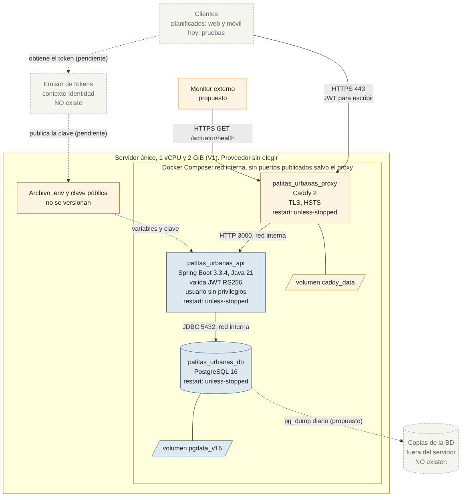

# Despliegue, observabilidad y operación — Semana 14

> **Estado: revisado por el equipo el 2026-11-06.** ADR-05 está aceptada: V1 con el proveedor por definir, observabilidad N1 y RPO de 24 h. **Los umbrales de alerta los confirmó el equipo** en la revisión manual S6 (2026-11-06).

Insumos: ADR-04, C4 (`dossier/06`, `dossier/07`), matrices de fallos y resiliencia (`docs/resiliencia/`), comparación de distribución (`docs/distribucion/comparacion-distribucion.md`) y experimentos 11 a 16.

**Clase de cada dato**, igual que en A4: **M** medido, **D** documentado en la configuración o el código, **E** estimado, **P** pendiente.

---

## 1. Diagrama de despliegue

El diagrama muestra lo que se propone para producción. Fuente: [`despliegue/diagrama-despliegue.mmd`](./despliegue/diagrama-despliegue.mmd). Imagen: [`despliegue/diagrama-despliegue.png`](./despliegue/diagrama-despliegue.png).

### Qué se ejecuta y dónde

| Elemento | Dónde se ejecuta | Red | Puertos | Hoy en `main` | Con el PR de seguridad |
|---|---|---|---|---|---|
| API (Spring Boot 3.3.4, Java 21) | Contenedor `patitas_urbanas_api` | Interna de Docker | 3000, sin publicar en producción | Publicado en todas las interfaces, HTTP en claro | Solo `127.0.0.1` en local; sin publicar en producción |
| PostgreSQL 16 | Contenedor `patitas_urbanas_db`, volumen `pgdata_v16` | Interna de Docker | 5432, sin publicar en producción | 5433 publicado en todas las interfaces | Solo `127.0.0.1` en local; sin publicar en producción |
| Proxy TLS (Caddy) | Contenedor `patitas_urbanas_proxy`, volumen `caddy_data` | Interna y pública | 80 y 443 | **No existe** | Solo en `docker-compose.produccion.yml` |
| Emisor de tokens | Externo | Internet | 443 | **No existe** | **Sigue sin existir**: decisión pendiente |
| Copias de la BD | Almacenamiento externo | Salida | — | **No existen** | **Siguen sin existir**: plan en §5 |

Los elementos que el dominio menciona y no existen en el código (Notificaciones, Servicio de Mapas, clientes web y móvil) no aparecen en el diagrama, igual que en la matriz de fallos.

### Comunicaciones

| Origen → destino | Protocolo | Autenticación | Estado |
|---|---|---|---|
| Cliente → proxy | HTTPS (443) | JWT en `Authorization` para escribir | Propuesto. Probado localmente con certificado interno, experimentos 14 y 15 |
| Proxy → API | HTTP, red interna de Docker | Ninguna | Propuesto. Riesgo aceptado: misma máquina (RS-13) |
| API → PostgreSQL | JDBC, red interna de Docker | Usuario y contraseña | Existente |
| Equipo → servidor | SSH | Clave | Propuesto, no configurado |

---

## 2. Alternativas de despliegue y costo relativo

La **forma** del despliegue ya está decidida: ADR-04 eligió D1 (una instancia). Lo que falta es **dónde** se ejecuta. Se toma V1 como base, con costo relativo 1,0.

| Dimensión | V0: equipo local | V1: un servidor con Compose (propuesta) | V2: PaaS con BD gestionada | D2 de ADR-04 | D3 de ADR-04 |
|---|---|---|---|---|---|
| Qué es | Computador del equipo, sin acceso público | 1 VPS con API, BD y proxy | Servicio web + PostgreSQL del proveedor | 2 API + balanceador + BD | 2 servicios + 2 BD |
| Sirve para producción | No | Sí | Sí | Sí | Sí |
| Infraestructura, USD/mes | 0 | ≈ 12 **(D, fuente secundaria †)** | ≈ 13: 7 del servicio de 512 MB + 6 de la BD más pequeña **(D, precio del proveedor ‡)** | ≈ 24 + balanceador **(E)** | ≈ 24 + 2 BD **(E)** |
| **Costo relativo de infraestructura** | 0 | **1,0** | **≈ 1,1** | **≥ 2,0** | **≥ 2,0** |
| Componentes que opera el equipo | 2 | 3 + el sistema operativo | 1 | 5 + el sistema operativo | 5 o más |
| TLS | No | Caddy **(M, exp. 15)** | Del proveedor | Por configurar | Por configurar |
| Copias de la BD | Manuales | Por construir | Las ofrece el proveedor; revisar qué incluye cada plan **(P)** | Por construir | Por construir, 2 veces |
| Parches del sistema operativo | Del equipo | Del equipo | Del proveedor | Del equipo | Del equipo |
| ¿La evidencia actual vale? | Sí | Sí: mismo Compose y mismas imágenes **(M)** | Parcial: cambia la red y la BD; habría que repetir exp. 11 y 12 | No medida | No medida |
| Reversibilidad | — | Alta: es Docker | Media: hay que exportar la BD | Alta | Baja |
| Compatibilidad con DA-03 (2 personas) | Sí | Sí, con trabajo de sistema operativo | Sí, la que menos operación pide | Parcial | No |
| Memoria necesaria | — | 2 GiB alcanzan **(E)**: API ≤ 0,31 GiB **(M, exp. 13)** | 512 MB quedan justos para la API: margen por medir **(P)** | — | — |

† Referencia de A4: DigitalOcean, 1 vCPU y 2 GiB, 12 USD/mes, de fuentes secundarias. El precio oficial sigue sin confirmar.
‡ [Página de precios de Render](https://render.com/pricing.md), consultada el 2026-11-05: servicio web de 512 MB a 7 USD/mes y PostgreSQL desde 6 USD/mes, en el plan Hobby sin cuota de espacio de trabajo. La página no indica fecha ni si ese plan de BD incluye copias.

**Lectura:** V1 y V2 cuestan casi lo mismo. La diferencia está en quién hace el trabajo: V1 conserva la evidencia medida, pero el equipo responde por el sistema operativo y las copias; V2 quita ese trabajo, pero obliga a repetir mediciones. D2 y D3 cuestan al menos el doble y ninguna medición las justifica (ADR-04).

**Propuesta:** V1, porque es lo que se ha medido. **El proveedor no está elegido** y por eso los precios en COP siguen pendientes.

---

## 3. Plan de observabilidad

### 3.1 Qué existe hoy

| Señal | Existe | Dónde | Sirve para | No sirve para |
|---|---|---|---|---|
| Logs de la API | Sí | `docker logs`, sin rotación | Excepciones, F-01, F-04 | Crecen con el log SQL en DEBUG (F-11). No hay log de accesos ni identificador de petición |
| `/actuator/health` | Sí | HTTP | Saber si la API y la BD están arriba | Tarda ~30 s con la BD caída (F-03) |
| `MEDICION_S6_CONTROLADOR_MS` | Sí | Log | Tiempo del controlador en `POST /api/adopciones` | Es instrumentación de un experimento |
| Estadísticas de Hibernate | Sí | Log en DEBUG | Depurar consultas | Son ruido en operación |
| `pg_stat_statements` | Sí | PostgreSQL | Consultas lentas | Nadie lo consulta de forma periódica |
| `docker inspect` (`RestartCount`) | Sí | Docker | Contar reinicios | Nadie lo revisa: con R-10, una caída **pasa desapercibida** |
| Métricas de la API | **No** | — | — | Actuator solo expone `health` |
| Trazas | **No** | — | — | — |
| Alertas | **No** | — | — | Hoy nadie se entera de una caída |

### 3.2 Qué se propone, por niveles

Con 2 personas (DA-03), un stack completo sería más trabajo que el sistema que vigila.

| Nivel | Cuándo | Logs | Métricas | Trazas | Alertas |
|---|---|---|---|---|---|
| **N1, mínimo** | Antes del primer despliegue público | R-09 (SQL a INFO), rotación de `json-file`, línea `AUDITORIA_ACCESO_DENEGADO` | Script cada minuto: `RestartCount`, disco y filas de `pg_stat_statements` | No hacen falta: hay un solo proceso | Monitor externo de `/actuator/health` y aviso del script |
| **N2, con usuarios reales** | Cuando haya tráfico real | Log de accesos con identificador de petición | Micrometer con Prometheus en un puerto de gestión **sin publicar**. Añade 2 contenedores | Identificador de petición en los logs | Reglas de §3.4 sobre métricas |
| **N3, solo si se distribuye** | Si aparece un segundo proceso (D2, D3 o Notificaciones) | Centralizados | Por servicio | OpenTelemetry | Por objetivo de nivel de servicio |

### 3.3 Señales por escenario de fallo

| Escenario | Señal | Tipo | ¿Existe hoy? | Cómo se conoce el alcance |
|---|---|---|---|---|
| F-01 BD caída | `/actuator/health` 503; errores de conexión en el log; `docker inspect` de la BD | Métrica + log | Sí | ¿`/buscar` sigue respondiendo? Si sí, solo caen las escrituras |
| F-02 BD recuperada | Primer `POST` con 201; `health` UP | Métrica | Sí | Contar 5xx desde la caída hasta la vuelta |
| F-03 `health` lento | Tiempo de respuesta de `health` > 5 s | Métrica | Parcial: el monitor externo lo mediría | Con tiempo de espera < 30 s, el monitor registra tiempo agotado y no 503 |
| F-05 cola de latencia | p95 y p99 de escritura | Métrica | No: solo con k6 | Por operación, en N2 |
| F-09 pool agotado | `hikaricp.connections.pending` > 0 | Métrica | No: es R-08 | Peticiones en espera y 5xx a los 30 s |
| F-10 hilos agotados | `tomcat.threads.busy` cerca de 200; `/buscar` falla | Métrica | No | Si `/buscar` también falla, afecta a todo |
| F-11 log crece | Tamaño de `/var/lib/docker/containers`; disco > 80 % | Métrica | No | Crecimiento por hora |
| F-12 proceso caído | `RestartCount` sube; monitor externo con caída corta | Métrica + log | Parcial | Tiempo entre `kill` y primer 200: < 10 s en reposo **(M, exp. 16)** |
| F-13 pérdida de datos | Filas después de reiniciar < filas antes | Métrica | No | Comparar el conteo con la última copia |
| T-01 abuso sin autenticación | Volumen de `AUDITORIA_ACCESO_DENEGADO` por origen | Log | Con el PR de seguridad | Orígenes, rutas y motivo |
| T-08 acceso directo a la BD | `pg_stat_activity` con conexiones fuera de la red interna | Log | No | Dirección y consultas |

### 3.4 Monitoreo y alertas

Umbrales confirmados por el equipo en la revisión manual S6 (2026-11-06, `docs/verificacion/revision-manual-s6-2026-11-06/`): se compararon la propuesta independiente de Kevin Torres y estos valores, y se eligieron estos para no saturar de alertas. AL-6 sigue siendo provisional hasta tener tráfico real. **Ninguna alerta está implementada.**

| Id | Condición | Ventana | Severidad | Fundamento | Acción |
|---|---|---|---|---|---|
| AL-1 | `/actuator/health` no responde 200 | 2 comprobaciones seguidas, tiempo de espera de 35 s | Crítica | F-01, F-03: con menos de 35 s no se ve el 503 | Plan P-1 o P-2 |
| AL-2 | `RestartCount` aumenta | 1 aumento | Alta | R-10 oculta las caídas | Plan P-2 |
| AL-3 | 5xx > 1 % | 5 min | Alta | Mismo límite de fallos que S11 | Plan P-1 o P-5 |
| AL-4 | p95 > 400 ms | 5 min | Media | La mitad del umbral de 800 ms del escenario 1 | Plan P-5 |
| AL-5 | Disco > 80 % | Instantánea | Alta | F-11 | Plan P-4 |
| AL-6 | Más de 100 líneas `AUDITORIA_ACCESO_DENEGADO` por origen | 1 min | Media | Valor sin medir con tráfico real: se ajusta al desplegar | Plan P-6 |
| AL-7 | La última copia de la BD tiene más de 26 h | Instantánea | Alta | RPO de 24 h | Plan P-3 |

### 3.5 Cómo se detecta un problema y se conoce su alcance

1. **¿Se cayó algo?** AL-1 o AL-2. El monitor externo sigue funcionando aunque caiga el servidor.
2. **¿Qué se cayó?** `docker compose ps`. Si la BD está caída, es F-01. Si la API se reinició, es F-12.
3. **¿A quién afecta?** Probar `/api/mascotas/buscar` (no usa la BD) y un `POST` con token. Si solo falla la escritura, la búsqueda sigue disponible.
4. **¿Desde cuándo?** La primera línea de error en `docker logs` y la hora de la alerta.
5. **¿Se perdieron datos?** Contar filas, y `solicitudes sin etapa` debe dar 0 (consulta de HF3, experimento 12).

---

## 4. Plan de operación y recuperación

**Objetivos de partida:** RTO de 120 s para una caída de proceso (escenario reformulado 2). RPO de 24 h, **propuesto**: nadie lo ha definido todavía.

| Plan | Situación | Señal | Qué se hace | Cómo se recupera | Se verifica con | ¿Probado? |
|---|---|---|---|---|---|---|
| P-1 | BD caída (F-01) | AL-1, AL-3 | Confirmar con `docker compose ps`. Revisar disco y logs de la BD | Sin `restart:` en local: `docker compose start postgres_db`. La API se reconecta sola, sin reiniciarla | `POST` con 201 y `health` UP | **Sí:** 3/3 ciclos, < 0,06 s desde `healthy` (S12, HF2) |
| P-2 | Proceso de la API caído (F-12) | AL-2 | Nada para volver: R-10 lo reinicia. Después, leer el log previo con `docker logs --tail 200` para saber la causa | Automática | Primer 200 y filas iguales | **Sí, en reposo:** 10/10 ciclos, < 10 s (exp. 16) |
| P-3 | Datos perdidos o corruptos (F-13) | AL-7, conteo de filas | Detener la API para evitar más escrituras | Restaurar la última copia con `pg_restore` en una BD nueva y apuntar la API | Conteos y 0 solicitudes sin etapa | **No:** no hay copias |
| P-4 | Disco lleno (F-11) | AL-5 | Identificar el contenedor con `docker system df -v` | Rotar logs, aplicar R-09 y ampliar disco si hace falta | Disco < 70 % | **No** |
| P-5 | Degradación de latencia (F-05, F-09) | AL-3, AL-4 | Revisar `pg_stat_statements`, CPU y conexiones | Según la causa. **La causa de F-05 sigue sin aislar** | p95 por debajo del umbral | **No**: falta R-08 |
| P-6 | Abuso o intento de acceso | AL-6 | Identificar el origen en el log de auditoría | Bloquear el origen en el proxy o en el firewall | La alerta se detiene | **No** |
| P-7 | Secreto filtrado | Aviso o hallazgo | Rotar la contraseña de la BD o la clave pública, y redesplegar | `docker compose up -d` con el `.env` nuevo | La credencial anterior falla | **No** |
| P-8 | Incidente con datos personales | Cualquiera, cuando existan esos datos | Contener, registrar y evaluar el aviso a la autoridad (art. 17 lit. n de la Ley 1581) | Según el caso | — | **No aplica todavía**: no hay datos personales |
| P-9 | Máquina perdida | AL-1 sin respuesta | Crear un servidor nuevo | Clonar el repositorio, restaurar `.env` y la última copia, y `docker compose up -d` | Prueba de humo de §3.5 | **No** |

### Copias de seguridad (propuesta)

Hoy **no hay ninguna copia**. Propuesta para V1: `pg_dump -Fc` una vez al día, guardado fuera del servidor, con 7 copias de retención. Una copia que no se ha restaurado no es evidencia: antes del primer despliegue público hay que hacer un simulacro de restauración y anotar cuánto tarda.

### Despliegue de una versión nueva

1. Fusionar en `main` con CI verde.
2. Hacer una copia manual de la BD.
3. `docker compose -f docker-compose.yml -f docker-compose.produccion.yml up -d --build`.
4. Ejecutar la prueba de humo: `health`, `/buscar` y un `POST` con token.
5. Si falla, volver a la imagen anterior. Con `ddl-auto=update`, el esquema no vuelve atrás solo: un cambio de esquema exige copia previa.

La indisponibilidad durante el despliegue es de unos 8 s, el arranque medido en reposo **(M, exp. 16)**. D1 no permite desplegar sin corte.

---

## 5. Riesgos operativos

La matriz está en [`13-riesgos-tradeoffs.md`](./13-riesgos-tradeoffs.md).

---

*Borrador de la IA, revisado por el equipo (Kevin Torres · Daniel Charry, 2026-11-06) · Semana 14 · Módulo 7 · Arquitectura de Software*
