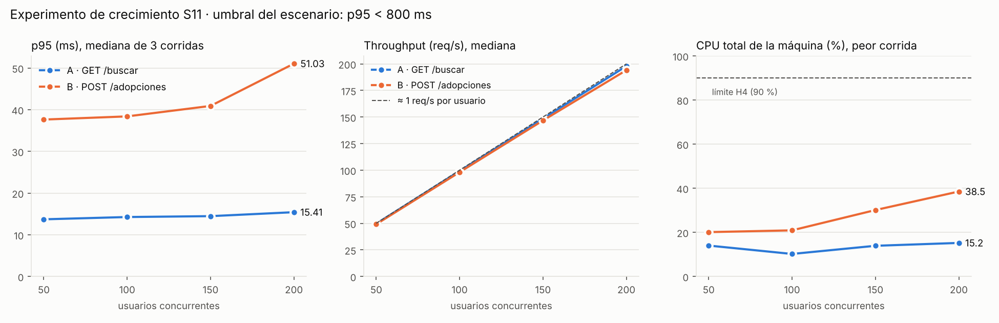

# Resultados — Experimento de crecimiento S11

> Escenario, hipótesis, procedimiento y reglas de análisis: [README.md](./README.md) (preregistrado en el commit `964dd4a`, 2026-10-16 18:49 -05). Desviaciones registradas antes de medir: [entorno/desviaciones.md](./entorno/desviaciones.md) (commit `c5ed512`, 19:08 -05). Las mediciones empezaron a las 19:08:51 -05 (00:08:51Z), después de ambos commits.

## 1. Cómo se obtuvo cada dato

| Dato | Valor |
|---|---|
| Fecha de ejecución | 2026-10-17, 00:08:39Z a 00:36:55Z (2026-10-16, 19:08 a 19:37 hora de Bogotá) |
| Código medido | `app/` igual al de `fb26713` (main). El experimento no cambia código de la aplicación |
| Imagen de la API | `patitas-urbanas-api:s11`. Jar SHA-256 `cf3c5a88…5938b`. Detalle en [resultados/entorno.txt](./resultados/entorno.txt) |
| Máquina | Contenedor Linux en la nube, Ubuntu 24.04.5, 2 vCPU Xeon 2.8 GHz, 7.8 GiB. **No es la máquina Windows/WSL2 de la línea base** |
| Software | Docker 29.8.2, PostgreSQL 16.15 (`postgres:16`), OpenJDK 21.0.12.1, k6 v2.2.0 (la misma versión de la línea base) |
| Generador y aplicación | En la misma máquina (§4, H4) |
| Semilla de datos | No aplica: las tablas empiezan vacías tras cada reinicio (`create-drop`). En la serie B crecen de 0 a 79 810 filas |
| Corridas | 2 operaciones × 4 escalones × 4 corridas = 32. Se descarta la corrida 1 de cada escalón. Todas las corridas terminaron con código de salida 0 |

Los archivos crudos de cada corrida están en `resultados/<operación>/`:
- `u<N>-c<C>.json`: resumen completo de k6;
- `.txt`: línea de resumen;
- `.cpu.csv`: CPU por segundo;
- `bitacora.txt`: horas de inicio y fin, código de salida y filas en la base de datos.

Las tablas de este documento salen de [`analizar.py`](./analizar.py), que genera:
- [resultados/corridas.csv](./resultados/corridas.csv): todas las corridas;
- [resultados/escalones.csv](./resultados/escalones.csv): medianas por escalón;
- [resultados/verificacion-hipotesis.txt](./resultados/verificacion-hipotesis.txt): veredicto de cada hipótesis.

## 2. Resultados por escalón (mediana de las corridas válidas 2, 3 y 4)

### Operación A — `GET /api/mascotas/buscar` (vinculada a la línea base)

| Usuarios | req/s | % del teórico | p50 (ms) | p95 (ms) | p99 (ms) | Fallos | 2xx / 4xx / 5xx / sin resp. | CPU k6 (% núcleo) | CPU máquina (%) |
|---:|---:|---:|---:|---:|---:|---:|---|---:|---:|
| 50 | 49.64 | 99.7 % | 2.53 | **13.70** | 31.29 | 0 % | 6000 / 0 / 0 / 0 | 3.9 | 14.0 |
| 100 | 99.22 | 99.6 % | 1.92 | **14.25** | 34.32 | 0 % | 12000 / 0 / 0 / 0 | 5.2 | 10.2 |
| 150 | 148.56 | 99.5 % | 2.15 | **14.46** | 50.75 | 0 % | 18000 / 0 / 0 / 0 | 8.1 | 13.9 |
| 200 | 197.86 | 99.3 % | 2.17 | **15.41** | 38.94 | 0 % | 24000 / 0 / 0 / 0 | 9.5 | 15.2 |

### Operación B — `POST /api/adopciones` (exploratoria, escribe en PostgreSQL)

| Usuarios | req/s | % del teórico | p50 (ms) | p95 (ms) | p99 (ms) | Fallos | 2xx / 4xx / 5xx / sin resp. | CPU k6 (% núcleo) | CPU máquina (%) |
|---:|---:|---:|---:|---:|---:|---:|---|---:|---:|
| 50 | 49.15 | 99.5 % | 8.55 | **37.62** | 64.71 | 0 % | 6000 / 0 / 0 / 0 | 5.1 | 20.1 |
| 100 | 98.12 | 99.3 % | 6.87 | **38.38** | 99.85 | 0 % | 12000 / 0 / 0 / 0 | 8.0 | 20.9 |
| 150 | 146.75 | 99.1 % | 7.01 | **40.89** | 97.70 | 0 % | 18000 / 0 / 0 / 0 | 11.9 | 30.1 |
| 200 | 194.04 | 98.6 % | 7.44 | **51.03** | 209.25 | 0 % | 23878 / 0 / 0 / 0 | 15.3 | 38.5 |

- **Códigos HTTP:** son la suma de las 3 corridas válidas.
- **CPU:** es la media de cada corrida y, de las 3 corridas válidas, se toma la mayor (regla conservadora de §6).
- **% del teórico:** se calcula como `N / (1 s + latencia media)`.

### Todas las corridas, incluidas las descartadas

| Op. | Usuarios | Corrida | Estado | Peticiones | req/s | p95 (ms) | Fallos | CPU máquina media / pico (%) |
|---|---:|---:|---|---:|---:|---:|---:|---|
| A | 50 | 1 | descartada | 2000 | 49.37 | 27.50 | 0 % | 17.9 / 35.6 |
| A | 50 | 2 | válida | 2000 | 49.64 | 13.70 | 0 % | 10.7 / 15.9 |
| A | 50 | 3 | válida | 2000 | 49.57 | 20.43 | 0 % | 14.0 / 27.1 |
| A | 50 | 4 | válida | 2000 | 49.70 | 9.95 | 0 % | 7.5 / 13.4 |
| A | 100 | 1 | descartada | 4000 | 99.00 | 19.91 | 0 % | 13.9 / 34.1 |
| A | 100 | 2 | válida | 4000 | 99.29 | 8.48 | 0 % | 10.2 / 22.0 |
| A | 100 | 3 | válida | 4000 | 99.17 | 15.50 | 0 % | 9.2 / 18.7 |
| A | 100 | 4 | válida | 4000 | 99.22 | 14.25 | 0 % | 8.3 / 16.5 |
| A | 150 | 1 | descartada | 6000 | 148.38 | 15.64 | 0 % | 12.1 / 20.2 |
| A | 150 | 2 | válida | 6000 | 148.56 | 14.46 | 0 % | 11.9 / 17.1 |
| A | 150 | 3 | válida | 6000 | 148.37 | 20.24 | 0 % | 13.9 / 29.4 |
| A | 150 | 4 | válida | 6000 | 148.58 | 13.87 | 0 % | 11.6 / 16.3 |
| A | 200 | 1 | descartada | 8000 | 198.03 | 15.89 | 0 % | 15.2 / 23.2 |
| A | 200 | 2 | válida | 8000 | 197.53 | 22.58 | 0 % | 15.2 / 21.9 |
| A | 200 | 3 | válida | 8000 | 197.86 | 13.80 | 0 % | 14.9 / 23.5 |
| A | 200 | 4 | válida | 8000 | 197.99 | 15.41 | 0 % | 14.8 / 20.5 |
| B | 50 | 1 | descartada | 1962 | 47.90 | 84.71 | 0 % | 29.1 / 49.5 |
| B | 50 | 2 | válida | 2000 | 49.08 | 38.74 | 0 % | 20.1 / 38.0 |
| B | 50 | 3 | válida | 2000 | 49.15 | 37.62 | 0 % | 19.1 / 44.1 |
| B | 50 | 4 | válida | 2000 | 49.31 | 24.79 | 0 % | 15.0 / 33.0 |
| B | 100 | 1 | descartada | 4000 | 97.95 | 37.66 | 0 % | 23.5 / 53.5 |
| B | 100 | 2 | válida | 4000 | 98.07 | 38.38 | 0 % | 20.9 / 28.5 |
| B | 100 | 3 | válida | 4000 | 98.18 | 39.53 | 0 % | 20.0 / 29.5 |
| B | 100 | 4 | válida | 4000 | 98.12 | 34.51 | 0 % | 19.6 / 26.8 |
| B | 150 | 1 | descartada | 6000 | 146.58 | 41.56 | 0 % | 28.9 / 42.9 |
| B | 150 | 2 | válida | 6000 | 146.87 | 42.52 | 0 % | 29.2 / 36.6 |
| B | 150 | 3 | válida | 6000 | 146.75 | 40.17 | 0 % | 29.5 / 40.9 |
| B | 150 | 4 | válida | 6000 | 146.72 | 40.89 | 0 % | 30.1 / 41.7 |
| B | 200 | 1 | descartada | 7970 | 194.34 | 47.50 | 0 % | 38.7 / 48.7 |
| B | 200 | 2 | válida | 7966 | 194.11 | 51.03 | 0 % | 38.5 / 52.5 |
| B | 200 | 3 | válida | 7957 | 194.04 | 57.21 | 0 % | 38.5 / 51.8 |
| B | 200 | 4 | válida | 7955 | 194.01 | 48.24 | 0 % | 37.3 / 47.8 |

## 3. Verificación de las hipótesis (criterios de README §3, sin cambios)

| Hipótesis | Criterio de refutación | Resultado |
|---|---|---|
| H1: A cumple p95 < 800 ms y < 1 % de fallos en los 4 escalones | Mediana del p95 ≥ 800 ms o fallos ≥ 1 % en algún escalón | **No refutada.** Peor escalón: 200 usuarios, p95 = 15.41 ms, 0 % de fallos |
| H2: el throughput de A es ≥ 90 % del teórico | < 90 % en algún escalón | **No refutada.** Mínimo: 99.3 % (200 usuarios) |
| H3: B cumple p95 < 800 ms y < 1 % de fallos | Igual que H1 | **No refutada.** Peor escalón: 200 usuarios, p95 = 51.03 ms, 0 % de fallos |
| H4: el instrumento no se satura | CPU de k6 ≥ 80 % de un núcleo, o CPU de la máquina ≥ 90 %, en alguna corrida válida | **No refutada.** Máximo de k6: 15.3 % de un núcleo. Máximo de la máquina: 38.5 % de media y 52.5 % de pico en un segundo |

## 4. Conclusión

### Hechos (lo que dicen los registros)

1. **No hubo fallos.** Ninguna de las 32 corridas tuvo respuestas 4xx, 5xx ni peticiones sin respuesta. El log de la API no tiene líneas WARN, ERROR ni Exception fuera del arranque ([resultados/verificacion-bd-y-logs.txt](./resultados/verificacion-bd-y-logs.txt)).
2. **Operación A.** Entre 50 y 200 usuarios la mediana del p95 pasó de 13.70 a 15.41 ms. La diferencia es menor que la variación entre corridas del mismo escalón: los p95 válidos de A van de 8.48 a 22.58 ms y los rangos de los escalones se superponen. **No se observa degradación de A atribuible a la carga.**
3. **Operación B.** Su latencia es mayor que la de A en todos los escalones y crece con la carga:
   - el p95 pasa de 37.62 a 51.03 ms (+36 %), y la mayor parte del aumento ocurre entre 150 y 200 usuarios (40.89 → 51.03 ms);
   - el p99 pasa de 64.71 a 209.25 ms (×3.2), y se duplica entre 150 y 200 usuarios.

   Es la **primera degradación observable** del experimento, aunque sigue muy por debajo del umbral de 800 ms.
4. **Throughput.** Siguió a la carga en ambas operaciones: ≥ 98.6 % del teórico. En B a 200 usuarios cada corrida completó entre 7955 y 7966 peticiones, no 8000, porque el ciclo de cada usuario dura un poco más de 1 s.
5. **Consistencia de los datos en B.** La suma de respuestas 2xx de B (79 810) coincide con las filas de `solicitud_adopcion` y de `etapa_adopcion`, y hay 0 solicitudes sin etapa. No se observaron escrituras perdidas ni a medias bajo carga.
6. **CPU.** En A la CPU de PostgreSQL fue 0 %, lo que es consistente con que `/buscar` no consulta la base de datos. En B la CPU de la máquina subió de 20 % a 38.5 % y la de PostgreSQL de 3.4 % a 11.9 %.

### Inferencias (compatibles con los datos, no demostradas)

- El crecimiento de la cola de latencia de B a 200 usuarios es compatible con contención en el camino de escritura. Los candidatos son:
  - el pool de Hikari, con 10 conexiones por defecto;
  - el log SQL en DEBUG, que generó unos 176 MB de log;
  - la CPU compartida por los tres procesos.

  **No se aisló cuál de ellos pesa más.** No se midió la espera por conexión de Hikari ni `pg_stat_statements`.
- Que A no se degrade es esperable porque devuelve una cadena fija. Esto **no dice nada** sobre cómo se comportaría una búsqueda geoespacial real, la limitación conocida desde la Semana 4.
- El p95 de A a 100 usuarios (14.25 ms) es unas 5.7 veces el de la línea base S5 (2.49 ms a 100 req/s). Como cambian la máquina, el modelo de carga (cerrado frente a abierto) y la red de contenedores, **la diferencia no puede atribuirse al código**.

### Lo que quedó sin verificar

- **El punto de quiebre.** Ninguna operación llegó al umbral ni dio errores hasta 200 usuarios. El experimento muestra que hay margen, pero no dónde termina. Para encontrarlo haría falta otra serie con más usuarios, preregistrada aparte.
- **La influencia de las filas acumuladas en B.** Las filas crecen junto con la carga (0 → 79 810), así que los dos efectos están confundidos. No hubo reinicio entre escalones porque el preregistro no lo preveía.
- **La reproducción en la máquina de la línea base** (Windows/WSL2) y con `docker compose up` usando el `app/Dockerfile` original.
- **La duración de los escalones.** Fueron de 40 s, así que efectos lentos como fugas, crecimiento de memoria o vacuum quedan fuera de alcance.

## 5. Insumos para la Semana 12 (solo lo que respalda esta evidencia)

- **ADR 4.** Con la carga probada, el monolito actual cumple el escenario con amplio margen. El componente que primero muestra degradación es la escritura transaccional en PostgreSQL (B), no la capa HTTP. Cualquier alternativa que añada saltos de red o mensajería tendría que justificar su costo frente a una mejora no demostrada aquí.
- **Matriz de fallos.** Hay evidencia observada de "latencia de cola creciente en escrituras a 200 usuarios". Siguen siendo suposiciones, sin evidencia:
  - "agotamiento del pool de conexiones";
  - "caída de PostgreSQL bajo carga".
- **Fitness function.** Este mismo script, con 200 usuarios y los umbrales `p(95)<800` y `rate<0.01` ya definidos en `escenario-crecimiento.js`, puede automatizarse para verificar la propiedad en CI.
